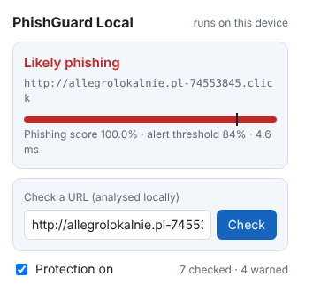
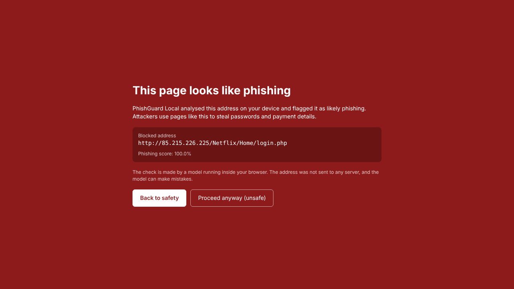

# 🛡️ PhishGuard ML

**Zero-Day Phishing URL Detection with a Hybrid Neural Network and On-Device Browser Inference**

[](LICENSE)
[](extension/)
[](https://onnxruntime.ai/)
[](https://www.python.org/)
[](https://nodejs.org/)
[](https://playwright.dev/)

> **Team NoPhishZone** · Department of Computer Science and Engineering, SRM University-AP, India  
> **Authors:** Vivek Verma · Rajan Jaiswal · Aman Maddheshiya · Yuvraj Verma  
> **Paper:** *Zero-Day Phishing URL Detection with a Hybrid Neural Network and On-Device Browser Inference*

---

## 📖 Abstract

Phishing detectors are usually reported on random train/test splits, which let near-duplicate URLs and reused domains leak into the test set and overstate how well a model will handle new, zero-day campaigns. We study phishing URL detection under **three protocols on the same data** — random, domain-disjoint, and strictly **chronological** — on 65,843 URLs combining timestamped PhishTank phishing URLs (Nov 2024–Oct 2026) with legitimate URLs from Tranco top-ranked sites.

We compare **Random Forest, XGBoost, a character-level CNN, two late-fusion schemes, and an early-fusion joint network** (character CNN + 67 lexical features). Thresholds are fixed at a **1% validation false-positive rate**, with confidence intervals from a domain-clustered bootstrap. Detection degrades sharply from random to chronological evaluation (XGBoost PR-AUC 0.987 → 0.926), yet the joint network keeps the **highest chronological PR-AUC of 0.957** (95% CI: 0.950–0.964) with **70.9% recall** at 1% FPR.

The **481 KB joint network runs entirely inside a Manifest V3 Chrome extension** through ONNX Runtime Web and scores a URL in **1.09 ms on average**, so **no visited address leaves the device**.

---

## 📸 Screenshots





---

## 🚀 Quick Start

### Install the Chrome Extension

1. Open `chrome://extensions` and enable **Developer mode** (toggle in the top right).
2. Click **Load unpacked** and select the `extension/` folder of this repository.
3. Click the extension icon and use **Check a URL** to score any address locally — nothing is sent to a server.
4. Open `chrome-extension://<extension-id>/benchmark.html` and click **Run benchmark** to measure on-device latency.

> ⚠️ Do not visit real phishing sites to test. Use the popup, the stubbed-network end-to-end test, or the benchmark page instead.

### Install JavaScript Dependencies (for tests)

```bash
npm install
```

---

## 🎯 Key Contributions

| # | Contribution | What it means |
|---|---|---|
| 1 | **Zero-day evaluation** | Same models under random, domain-disjoint, and strictly chronological splits on 65,843 URLs, thresholds fixed at 1% validation FPR, domain-clustered bootstrap intervals. |
| 2 | **Hybrid model + ablation** | Random Forest, XGBoost, character CNN, two late-fusion schemes (average, stacking), and an early-fusion joint network — each compared at a fixed 1% FPR. |
| 3 | **Robustness analysis** | Six URL edits, three prevalence levels, three training seeds; identifies a benign-looking deep-path weakness. |
| 4 | **Private real-time deployment** | 481 KB ONNX model in a Manifest V3 Chrome extension with a verified JavaScript feature port; latency and memory measured against a local HTTP API baseline. |

---

## 🗃️ Data

| Class | Source | Count | Notes |
|---|---|---|---|
| **Phishing** | PhishTank online-valid feed | 31,178 | November 2024 – October 2026, each with a submission timestamp |
| **Legitimate** | Tranco top-100k domains | ~38,609 | Same-site links from 6,000 homepages + 12,735 bare homepage URLs (33% domain-only per class, matching phishing) |

After cleaning, the dataset has **69,787 URLs**. Domains appearing in both classes (free hosting, shorteners) were removed. For the chronological split, 3,944 phishing URLs were dropped so no domain appears in two splits — leaving **65,843 URLs** for modeling.

### Evaluation Splits

| Split | Construction | Purpose |
|---|---|---|
| **Random** | Stratified 70/15/15 | Reference only — upper bound, prone to leakage |
| **Domain-disjoint** | Whole registered domains assigned to train / validation / test | Tests generalisation to unseen domains |
| **Chronological** | Phishing split by submission time (val from 2026-06-21, test from 2026-08-14), domain-disjoint across splits; legitimate URLs split by domain | **True zero-day** — tests detection of future campaigns |

Phishing domains are strongly reused over time: **56% of validation** and **28% of test** phishing URLs in the chronological split fell on domains already seen in an earlier split and were removed.

---

## 🤖 Models

| Model | View | Input | Parameters |
|---|---|---|---|
| **Random Forest** | Lexical | 67 handcrafted features (lengths, entropy, TLD, brand, keywords, IP host, punycode, …) | ~300 trees |
| **XGBoost** | Lexical | 67 handcrafted features | 400 trees, depth 6, rate 0.1 |
| **Character CNN** | Character | First 200 characters of URL (scheme removed), 95-symbol vocabulary | 105,889 |
| **Late fusion (average)** | Character + Lexical | Validation-tuned weighted average of XGBoost + CNN scores | — |
| **Late fusion (stacking)** | Character + Lexical | Logistic-regression stacking of XGBoost + CNN scores | — |
| **Joint network** *(deployed)* | Character + Lexical | Early fusion: CNN branch concatenated with 64-unit lexical branch, two-layer head | **122,529** |

## Results

Threshold fixed on the validation set at 1% false-positive rate. Cells show PR-AUC / recall at that threshold.
Test sets: random and domain-disjoint about 40% phishing, chronological 37% phishing.

| Model | Random | Domain-disjoint | Chronological |
|---|---|---|---|
| Random Forest | 0.987 / 0.905 | 0.959 / 0.681 | 0.908 / 0.609 |
| XGBoost | 0.987 / 0.904 | 0.965 / 0.771 | 0.926 / 0.618 |
| Character CNN | 0.990 / 0.927 | 0.949 / 0.638 | 0.932 / 0.614 |
| Late fusion: weighted average | 0.993 / 0.942 | 0.975 / 0.817 | 0.950 / 0.700 |
| Late fusion: stacking | 0.994 / 0.956 | 0.978 / 0.815 | 0.955 / 0.725 |
| **Joint network (deployed)** | 0.993 / 0.953 | 0.975 / 0.792 | **0.957 / 0.709** |

- On the chronological split the joint network's PR-AUC 95% CI [0.950, 0.964] does not overlap that of the best single model, the
  character CNN [0.924, 0.940]. On the random and domain-disjoint splits the intervals overlap, so the gain is not statistically established there.
- The three fusion strategies are statistically indistinguishable.
- Over 3 training seeds (chronological split) the joint network reaches PR-AUC 0.955 ± 0.005 and recall 0.708 ± 0.015.
  XGBoost is deterministic in this setup, so it has no seed variance.
- A random split overstates performance: at the default 0.5 threshold XGBoost has F1 0.947 on the random split and 0.795 on the chronological split.

### Robustness (chronological split, joint network, recall at the 1% FPR threshold)

| Attack applied to phishing URLs | XGBoost | Char CNN | Joint network |
|---|---|---|---|
| None (clean) | 0.618 | 0.614 | 0.709 |
| Long random query padding | 0.962 | 0.974 | 0.965 |
| Trusted-domain subdomain prefix | 0.995 | 0.999 | 1.000 |
| Leetspeak host substitution | 0.753 | 0.578 | 0.895 |
| Benign-looking deep path appended | 0.658 | 0.446 | 0.575 |
| Percent-encoded path | 0.592 | 0.579 | 0.685 |

Most of these edits make a URL look more suspicious, so recall rises. The real weakness is the **benign-looking deep path**, which lowers
the recall of the character-based models. This matches a path-length bias in the legitimate data (see Limitations).

Class imbalance (joint network): PR-AUC 0.957 at the natural 37% phishing share, 0.813 at 5% and 0.684 at 1%;
precision falls to 0.371 at 1% prevalence while recall stays near 0.72. Real browsing has far fewer phishing URLs than the test set.

### Ablation: Chronological test split (95% domain-clustered bootstrap CI)

| Model | PR-AUC (95% CI) | Precision | Recall | F1 | Test FPR |
|---|---|---|---|---|---|
| Random Forest (lexical) | 0.908 [0.896–0.918] | 0.955 | 0.609 | 0.744 | 0.017 |
| XGBoost (lexical) | 0.926 [0.916–0.936] | 0.968 | 0.618 | 0.754 | 0.012 |
| Character CNN (chars) | 0.932 [0.924–0.940] | 0.974 | 0.614 | 0.753 | 0.009 |
| Late fusion (average) | 0.950 [0.942–0.956] | 0.974 | 0.700 | 0.815 | 0.011 |
| Late fusion (stacking) | 0.955 [0.949–0.962] | 0.972 | 0.725 | 0.831 | 0.012 |
| **Joint network** | **0.957 [0.950–0.964]** | 0.971 | **0.709** | 0.820 | 0.012 |

---

## On-device deployment

The extension (`extension/`) scores every main-frame navigation locally and redirects flagged pages to a warning page.
Details, install steps and the test suite are in [`extension/README.md`](extension/README.md).

Measured in Chrome 156 on an 8-core MacBook (500 URLs, single run, repeated twice with the same result):

| Metric | Value |
|---|---|
| Model file | 481 KB (plus an 11 MB shared WebAssembly runtime) |
| Model load, once per browser start | 73 ms |
| Preprocessing + inference per URL | mean 1.09 ms, p95 1.2 ms, p99 1.2 ms |
| Extension round trip (service worker to offscreen document and back) | mean 1.72 ms, p95 1.9 ms |
| Same model as an HTTP API on localhost (native ONNX Runtime) | mean 1.01 ms, p95 1.2 ms |
| Memory footprint in Chrome Task Manager (extension process) | 82.3 MB |

On localhost the API is slightly faster than the extension, and it contains no network delay (a lower bound for any real server).
Local inference is therefore justified by **privacy** (no URL leaves the device), **independence from a server and from network failures**,
and no server cost, not by raw latency.

Verification: JavaScript and Python features agree on 2,000 held-out URLs (0 mismatches) and on 196 edge cases (0 mismatches);
ONNX probabilities agree within 4.5e-7 with 0 decision flips; an end-to-end browser test passes in Chromium.

## Repository layout

| Path | Content |
|---|---|
| `notebooks/project.ipynb` | Data collection, EDA, splits, models, ablation, robustness, ONNX export |
| `src/features.py` | Python feature extractor used in training |
| `extension/` | Chrome extension (Manifest V3, ONNX Runtime Web) |
| `server/` | Same model as an HTTP API for the latency comparison |
| `tests/` | Parity, edge-case and browser end-to-end tests |
| `results/` | Benchmark output and screenshots |

## Limitations

- The legitimate URLs come from homepage links, so their paths are longer than the phishing paths (single-feature AUC of path length 0.745).
  Bare-domain URLs were balanced across classes and path features were not removed. A second legitimate source would remove this bias.
- Legitimate URLs have no timestamps, so the chronological split is time-ordered for phishing URLs only.
- Only the URL string is analysed; there are no page content, certificate or WHOIS features.
- Results come from a single dataset, a single data collection window and one validation-selected threshold.
- Manifest V3 cannot block a navigation synchronously; the warning page replaces the tab a few milliseconds after the navigation starts.
- Performance numbers are from one machine and one run per measurement.

---

## 📚 Related Work (at a glance)

This work differs from recent studies by combining **strict zero-day splits**, **hybrid character+lexical fusion**, **on-device browser deployment**, and **measured latency/memory**:

| Study | Year | Method | Dataset | Key result | How we differ |
|---|---|---|---|---|---|
| BiLSTM / char-embedding | 2025 | 4-class classification | ~650k Kaggle URLs | ~97% accuracy | Domain & time-disjoint splits; 1% FPR threshold |
| Multi-kernel CNN + BiGRU | 2025 | Deep URL model | 522k Kaggle URLs | 98.46% acc, AUC 0.996 | Tests on unseen domains and future URLs |
| Wide-and-deep CNN + lexical | 2026 | CNN + 40 features | ~6.1M Kaggle URLs | 98.9% acc | Same fusion idea, but zero-day protocol + on-device |
| CNN + LightGBM ensemble | 2025 | 60/40 ensemble | PhishTank + Tranco, 99k URLs | 99.82% acc | Chronological split + obfuscation tests |
| BERT on 3B URLs | 2024 | Pre-trained transformer | GramBeddings, Dmoz, ad URLs | 0.974 phishing acc | 122k-parameter model; seeds and bootstrap CIs |
| ModernBERT few-shot | 2025 | Few-shot + features | 88k + 235k URLs | 99.9% acc, 10 examples/class | Strict splits; 1.09 ms with 481 KB model |
| MobileBERT page source | 2026 | Client-side transformer | PhishPedia, 30k+30k | 91%+ zero-day, 7× less memory | URL only, no page fetch; 82 MB total memory |
| RF + Grey Wolf extension | 2026 | Chrome extension | PhishTank 2024, UCI, 80k | 98.7% acc, MCC 0.96 | Time-ordered evaluation; local neural model |
| RF/SVM/kNN extension | 2024 | Chrome extension | UCI phishing, 11k pages | RF recall 0.970 | Larger timestamped data; latency measured |
| XGBoost + SHAP | 2024 | Cross-dataset | 88k + 19k URLs | 97–99% in-dataset, 51–59% cross-dataset | Disjoint protocols + fusion remedy |
| Graph autoencoder DOM | 2026 | GAT on domain+DOM | PhishPedia 6k sites | F1 93.9%, ~20 ms/page | URL string only; no page download |

---

## 📄 Citation

If you use this work, please cite:

```
@article{nophishzone2026,
  author    = {Vivek Verma and Rajan Jaiswal and Aman Maddheshiya and Yuvraj Verma},
  title     = {Zero-Day Phishing URL Detection with a Hybrid Neural Network and On-Device Browser Inference},
  journal   = {Department of Computer Science and Engineering, SRM University-AP},
  year      = {2026},
  note      = {Team NoPhishZone}
}
```

**Repository:** `https://github.com/vivekcode12345/phishguard-ml`

## Reproducibility

The notebook rebuilds the data and produces the reported splits, models, robustness experiments and ONNX export.
Open `notebooks/project.ipynb` in Colab or Jupyter and run its cells in order. The source data is not committed.

Install the JavaScript dependencies and run the parity and edge-case checks with:

```bash
npm install
npm run test:parity
npm run test:edge
```

For the browser test, install the Playwright browser and run:

```bash
npx playwright install chromium
npm run test:e2e
```

The extension benchmark is run manually from `chrome-extension://<extension-id>/benchmark.html`; append
`?api=http://127.0.0.1:8787/score` when comparing with the local HTTP API.