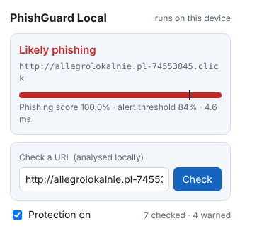
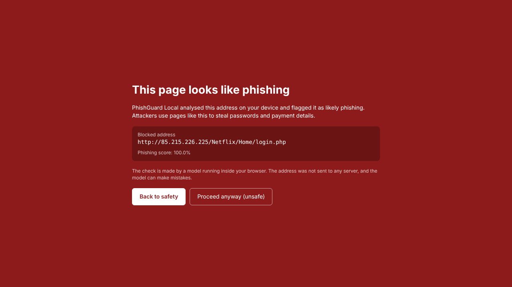

# PhishGuard Local: on-device phishing URL detection (Chrome extension)

A Manifest V3 Chrome extension that classifies every main-frame navigation with the project's
**joint network** (character-level CNN branch + 67 handcrafted lexical features) running
**inside the browser** with ONNX Runtime Web (WebAssembly). URLs are never sent to a server and no
browsing history is stored (only two counters: URLs checked and warnings shown).

## Contents

- [Quick start](#quick-start)
- [Repository layout](#repository-layout)
- [How it works](#how-it-works)
- [Tests](#tests)
- [Performance](#performance)
- [Limitations](#limitations)
- [Screenshots](#screenshots)

## Quick start

1. Open `chrome://extensions` and enable **Developer mode**.
2. Click **Load unpacked** and select this `extension/` folder.
3. Click the extension icon and use **Check a URL** to score an address locally.
4. Open `chrome-extension://<extension-id>/benchmark.html` and click **Run benchmark**.

Do not visit real phishing sites to test; use the popup or the stubbed-network test.

## Repository layout

| Path | Content |
|---|---|
| `extension/` | The unpacked Chrome extension (load this folder in Chrome) |
| `extension/lib/features.js` | JavaScript port of `src/features.py` (Python `urlparse` + `tldextract` behaviour) |
| `extension/lib/engine.js` | Loads the ONNX model and scores URLs |
| `extension/model/` | `phishing_joint.onnx` (481 KB), `preprocess.json` (scaler, threshold, character map), `psl_icann.json` (public suffix list) |
| `extension/vendor/` | ONNX Runtime Web 1.20.1 (WebAssembly runtime, 11 MB) |
| `server/server.mjs` | Same model behind an HTTP API; baseline for the local-vs-API comparison |
| `src/features.py` | Python reference feature extractor used for training |
| `tests/` | Parity tests, edge-case tests and the end-to-end browser test |
| `results/` | Benchmark output and screenshots |

## How it works

```
navigation (main frame)
   -> service worker (background.js)  -- message -->  offscreen document (offscreen.js)
                                                      features.js -> ONNX Runtime Web (WASM)
   <-- probability --------------------------------
   probability >= threshold (0.836, 1% false-positive rate on the validation set)
        -> redirect the tab to warning.html ("Back to safety" / "Proceed anyway")
   otherwise -> badge "OK"
```

The model runs in an offscreen document because service workers cannot load the WebAssembly
glue code of ONNX Runtime Web. Permissions: `webNavigation`, `storage`, `offscreen`, `activeTab`.
The extension makes no network requests.

## Install and try it

1. Open `chrome://extensions`, enable **Developer mode**, click **Load unpacked**, select the `extension/` folder.
2. Click the extension icon and use **Check a URL** to score any address (analysed locally).
   Do not visit real phishing sites to test; use the popup or the stubbed-network test below.
3. Open `chrome-extension://<extension-id>/benchmark.html` and click **Run benchmark** to measure latency on your machine.

## Tests

```bash
npm install
npm run test:parity   # 2,000 URLs: JS features and probabilities vs Python
npm run test:edge     # 196 hard cases (IDN, IPv4/IPv6, userinfo, ports, params, no scheme, ...)
npx playwright install chromium
npm run test:e2e      # loads the extension in Chromium with stubbed network; also runs the benchmark
```

| Test | Result |
|---|---|
| Feature parity (2,000 held-out URLs) | 0 mismatching rows, max abs. difference 4.4e-15 |
| Probability parity, JS + ONNX Runtime vs Python + ONNX Runtime | max abs. difference 4.5e-7, 0 / 2,000 decision flips |
| Edge cases (196 URLs, generated with the Python reference) | 0 mismatches |
| Browser end-to-end (Chromium 153) | phishing-flagged URLs show the warning page, benign URLs get the "OK" badge, "Proceed anyway" works, popup works |

## Performance (single run; Chromium 153 on a 2-core Linux container, so re-run on your own machine for the paper)

| Metric | Value |
|---|---|
| Model file | 481 KB (ONNX), 122,529 parameters |
| ONNX Runtime Web WebAssembly binary | 11 MB (shared by any model; total unpacked extension about 12 MB) |
| Model load (fetch + session creation) | 142 ms, once per browser start |
| Preprocessing (features + encoding), per URL | mean 0.05 ms, p95 0.10 ms |
| Inference, per URL | mean 1.52 ms, p50 1.50 ms, p95 2.00 ms, p99 3.00 ms |
| Local total (preprocessing + inference), per URL | mean 1.58 ms, p95 2.10 ms |
| Extension round trip (page -> service worker -> offscreen document -> back) | mean 4.68 ms, p50 4.60 ms, p95 6.80 ms |
| Same model behind an HTTP API on **localhost** | mean 6.23 ms, p50 5.70 ms, p95 9.70 ms |
| JS heap of the benchmark page | 8.8 MB before load, 11.1 MB after load, 17.8 MB after 700 predictions |
| Renderer process RSS (extension pages) | about 215 MB with the offscreen engine loaded; about 281 MB after the benchmark page loaded a second engine |

Notes for interpreting the numbers:

- The API baseline ran on the same machine, so it contains **no network latency** and is a lower bound.
  On a real network, add the round-trip time to the server (and the server must receive every visited URL).
  On localhost the extension and the API are within about 1 ms of each other, so the case for local
  inference rests on **privacy and independence from a backend**, not on raw speed.
- `performance.now()` is coarsened to 0.1 ms in extension pages, so sub-0.1 ms values are rounded.
- RSS includes the Chromium renderer baseline. Use `chrome://task-manager` for the footprint of "Extension: PhishGuard Local".

## Limitations

- Manifest V3 cannot block a navigation synchronously. The tab is redirected to the warning page as soon as
  scoring finishes (a few milliseconds after the navigation event), so the page request may already have started.
- Only the URL string is analysed (no page content, no WHOIS or certificate data). Accuracy numbers and the
  weaknesses found in robustness testing (for example benign-looking deep paths) are documented in the project report.
- Feature extraction is case-sensitive like the training code. Chrome lower-cases hostnames, while a few
  training URLs had upper-case hosts, which is a negligible train/deploy difference.
- The public suffix list is a snapshot (`psl_icann.json`) and should be refreshed when the model is retrained.

## Screenshots




